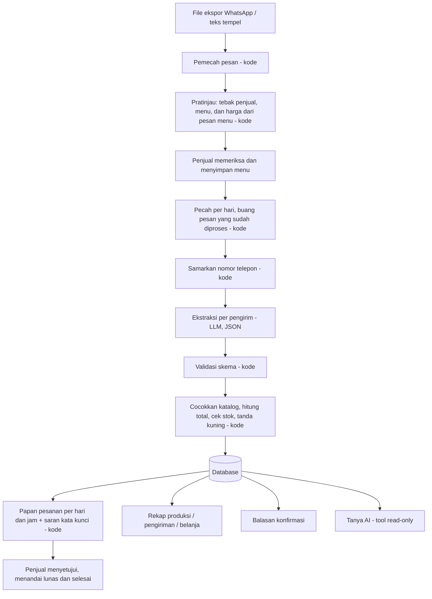

# Rekapesan

> **Dari chat grup jadi rekap pesanan, tanpa salin ulang.**

[](https://github.com/Baswara06/Rekapesan/actions/workflows/ci.yml)

Buku pesanan harian dari chat WhatsApp untuk penjual makanan rumahan. Penjual cukup memasukkan ekspor chat, lalu pesanan tersusun per hari dan per jam, lengkap dengan mana yang harus diproses dan mana yang belum bayar.
Dibuat untuk **LOGICODIX 2026** (HIMTI UNESA).

| | |
| --- | --- |
| **Kategori** | Web (mobile-first, PWA) |
| **Subtema** | Local MSME and Creative Economy |
| **Demo (deploy)** | https://rekapesan.my.id |
| **Video demo** | _isi tautan YouTube_ |
| **Akun demo** | nama pengguna `demo` / kata sandi `demo`. Bisa juga **Daftar** akun baru di layar Masuk |

---

## 1. Tim dan kontribusi

| Nama | Peran | Kontribusi |
| --- | --- | --- |
| Raihan | Backend, Hustler | CRUD API, auth, templat balasan, deploy, integrasi, wawancara penjual, video, README |
| Satria | Backend, ketua tim | Skema DB, mesin aturan, orkestrasi impor, rekap, parser ekspor WhatsApp, impor ulang, anonimisasi, data uji |
| Pangeran | Backend (AI) | Ekstraktor LLM, agen tanya-jawab, bukti bayar, evaluasi |
| Amad | Frontend | Seluruh antarmuka, PWA, aksesibilitas, uji pemakaian |

Rincian tugas: [`docs/PEMBAGIAN_TUGAS.md`](docs/PEMBAGIAN_TUGAS.md)

---

## 2. Masalah dan pengguna

**Pengguna:** penjual makanan rumahan (katering harian, lauk, kue, jajanan, delivery ayam bakar) yang menerima pesanan lewat chat atau grup WhatsApp, baik dengan sistem PO maupun pesanan harian biasa.

> Penjual makanan perlu merekap pesanan dari chat WhatsApp, tetapi harus menggulir chat dan menyalin satu per satu ke buku atau Excel, sehingga ada pesanan terlewat, total salah hitung, jam kirim tertukar, dan sulit melihat mana yang sudah dikirim atau sudah dibayar.

Tiga tanda masalah layak digarap:

| Tanda | Kondisi |
| --- | --- |
| Berulang | Terjadi setiap hari pesanan dibuka |
| Informasi berantakan | Pesanan tersebar di ratusan baris chat bercampur obrolan, ubah, dan batal |
| Keputusan tertunda | Jumlah masak, urutan kirim, dan tagihan baru diketahui setelah rekap manual selesai |

### Bukti lapangan (diukur tim)

Wawancara dan pengukuran tim dengan dua penjual. Angka ditulis apa adanya, tanpa dibulatkan atau diperkirakan.

| Ukuran | Hasil |
| --- | --- |
| Jumlah penjual yang diwawancarai | 2 |
| Waktu rekap manual, diukur dengan stopwatch | 45-60 menit |
| Waktu rekap dengan Rekapesan, chat yang sama | 5-15 menit |
| Skor "mudah dipakai", "hasil bisa dipercaya", "menghemat waktu" (1-5) | 4 |
| Fitur yang paling dibutuhkan (survei singkat lewat chat) | Rekap pesanan dan asisten AI |

### Bukti pendukung (bukan hasil pengukuran tim)

Tiga sumber di bawah dibaca pada 13 November 2026. Isinya menunjukkan **di mana** penjual UMKM berjualan dan bagaimana cara lama dijalankan. Isinya **tidak** mengukur berapa lama rekap PO manual.

**1. WhatsApp adalah platform yang paling sering dipakai penjual online UKM.** Survei Paxel Buy & Send Insight terhadap 535 penjual online UKM (29 Juli sampai 4 Agustus 2019, separuh responden penjual makanan) melaporkan platform yang paling sering dipakai. Satu responden boleh memakai lebih dari satu platform, jadi totalnya melebihi 100%.

| Platform | Dipakai oleh |
| --- | --- |
| WhatsApp | 84% |
| Instagram | 81% |
| Shopee | 53% |
| Facebook | 36% |
| Tokopedia | 29% |
| Bukalapak | 18% |

Sumber: Elisabeth Adventa, "Riset Paxel: Mayoritas UMKM online pilih medsos dan layanan same day delivery", Kontan, 2 Oktober 2019. Datanya berumur lebih dari tujuh tahun.

**2. Perpesanan dipakai mayoritas UMKM Indonesia.** Riset Boston Consulting Group dan Meta (2024), seperti dikutip UKM Indonesia, menyebut perpesanan murni dan perpesanan media sosial paling banyak dipakai pelaku bisnis di Indonesia: 90% perusahaan besar dan 83% UMKM. Artikel pengutipnya tidak menyebut jumlah sampel, metode, maupun periode survei, dan angka ini mencakup dua jenis saluran, bukan WhatsApp saja. Klaim "penjualan naik tiga kali lipat" di artikel yang sama berasal dari satu studi kasus Kopi Kenangan, bukan dari survei, sehingga tidak kami pakai.

Sumber: Annisa Anastasya, "Perpesanan Bisnis Bikin Penjualan Naik Tiga Kali Lipat? Riset BCG dan Meta Ungkap Fakta Menarik Ini", UKM Indonesia, 26 Agustus 2024.

**3. Cara lama: pesanan diteruskan manual dan bukti transfer dicocokkan satu per satu.** Artikel panduan WhatsApp untuk bisnis F&B dari SleekFlow menggambarkan cara lama sebagai "grup WhatsApp staf tempat pesanan diteruskan manual" dan menyebut bahwa "staf harus mencocokkan foto bukti transfer satu per satu" untuk pesanan, PO hampers, dan katering. SleekFlow adalah vendor perangkat lunak percakapan, jadi ini gambaran kualitatif dari pihak yang berjualan produk, bukan riset independen, dan tanpa data seberapa sering atau seberapa besar masalahnya.

Sumber: Kalyca Kris, "WhatsApp untuk Bisnis F&B: Cara Restoran, Kafe, dan Katering Mengelola Reservasi, Pesanan, dan Pertanyaan Halal dari Satu Nomor", SleekFlow (tanpa tanggal terbit, terakhir diubah 27 Oktober 2026).

### Keterbatasan bukti

- Sumber pendukung menunjukkan bahwa penjual berjualan lewat chat, bukan berapa menit rekap manual atau seberapa sering salah. Angka waktu hanya berasal dari pengukuran kami sendiri.
- Wawancara kami hanya dua penjual, jadi tidak bisa digeneralisasi ke seluruh penjual.
- Satu sumber berasal dari vendor, satu sudah berumur lebih dari tujuh tahun, dan satu tidak menyebut sampel dan metode.
- Kami tidak memakai angka dari sumber lain untuk menyimpulkan lama atau kesalahan rekap manual, dan tidak membandingkannya dengan waktu hasil ukur kami.

---

## 3. Solusi

Penjual tidak perlu membuat PO atau mengisi katalog dari nol. Cukup masukkan ekspor chat WhatsApp (atau tempel teksnya). Sistem:

1. membaca daftar menu dan harga dari pesan menu penjual di chat dengan **kode**, lalu penjual memeriksa dan menyimpannya,
2. memecah chat per hari dan melewati pesan yang sudah pernah diproses,
3. menyamarkan nomor telepon,
4. memakai LLM **hanya** untuk memahami maksud pesanan dari teks bebas, per pengirim,
5. menghitung harga, total, dan stok dengan **kode biasa** dari katalog penjual,
6. menandai pesanan meragukan (tanda kuning) dan menunggu **persetujuan penjual**,
7. menyusun papan pesanan per hari dan per jam: yang perlu diproses, yang selesai, yang sudah dan belum bayar,
8. menghasilkan rekap produksi, urutan kirim, omzet, daftar belanja, dan balasan konfirmasi, serta menjawab pertanyaan lewat Tanya AI.

### Pembagian kerja AI dan kode

| Pekerjaan | Pelaksana |
| --- | --- |
| Memecah file ekspor menjadi pesan dan per hari | Kode |
| Menebak daftar menu dan harga dari pesan menu penjual | Kode (penjual memutuskan) |
| Memahami maksud dan isi pesanan dari teks bebas | LLM |
| Harga, total, sisa stok | Kode |
| Menandai pesanan bermasalah | Kode |
| Saran "sudah bayar" dan "sudah terima" dari isi chat | Kode, kata kunci (penjual memutuskan) |
| Membaca nama dan nominal dari foto bukti transfer | LLM vision, hanya bila penjual memilihnya. Cocok atau beda dengan total dihitung kode (penjual memutuskan) |
| Memutuskan pesanan bermasalah, pelunasan, dan pesanan selesai | Penjual |
| Menjawab pertanyaan tentang pesanan | LLM dengan tool read-only, jawaban disertai langkahnya |

Harga tidak pernah dikirim ke LLM dan tidak pernah berasal dari LLM, sehingga manipulasi lewat isi chat (mis. "ubah harga jadi 1000") tidak mengubah tagihan.

### Alur pemakaian

1. **Daftar**: nama toko, nama pengguna, kata sandi (minimal 8 karakter), ulangi kata sandi. Setelah daftar langsung masuk.
2. **Masukkan chat**: unggah ekspor chat WhatsApp (`.txt`, atau `.zip` dengan maupun tanpa media) atau tempel teksnya. Tidak ada langkah membuat PO. Bila `.zip` berisi media, penjual bisa mencentang **Baca bukti transfer dari foto**: foto dari pembeli yang punya pesanan di hari itu (maksimal 30) dibaca AI menjadi saran nama dan nominal.
3. **Cek menu**: kode menebak penjual serta daftar menu dan harga dari pesan menu di chat. Penjual memeriksa, mengubah bila perlu, lalu menyimpan. Menu yang disebut pembeli tetapi tidak ada di daftar menu ditampilkan terpisah tanpa harga, penjual yang memutuskan.
4. **Proses pesanan**: chat dipecah per hari (maksimal 14 hari terakhir), AI membaca isi pesanan, kode menghitung total dan tanda kuning.
5. **Papan pesanan** di Beranda:
   - **Perlu diproses**: per hari lalu per jam kirim. Pesanan yang perlu dicek, yang sedang diproses, dan yang belum bayar, ditambah ringkasan keseluruhan dan omzet.
   - **Riwayat**: pesanan yang sudah selesai dan lunas.
   - **Saran dari chat**: mis. "Pembeli bilang sudah bayar" dari kalimat "udah transfer ya kak". Status baru berubah setelah penjual menekan **Tandai lunas** atau **Tandai selesai**.
6. **Cek pesanan**: chat asli berdampingan dengan hasil AI, ubah item, jam, alamat, lalu setujui, tolak, atau setujui semua yang bersih. Salin balasan konfirmasi ke WhatsApp.
7. **Rekap** per hari: jumlah masak per menu, urutan kirim, omzet, belum bayar, daftar belanja.
8. **Tanya AI**: mis. "Ketumbar jam 12 berapa porsi?". Agen membaca semua hari milik akun, langkahnya ditampilkan, dan percakapan tersimpan 30 hari.
9. **Pengaturan**: hapus data per hari beserta pesan mentahnya.

---

## 4. Fitur

Dicentang hanya bila sudah ada di server demo dan punya uji otomatis.

- [x] Daftar dan masuk akun penjual dengan nama toko, data tiap akun terpisah
- [x] Masukkan chat tanpa membuat PO: ekspor `.txt` / `.zip` (dengan atau tanpa media) atau tempel teks, dipecah per hari
- [x] Cek menu: daftar menu dan harga ditebak kode dari pesan menu penjual, penjual yang menyimpan
- [x] Menu yang dipesan pembeli tetapi belum ada di katalog: ditampilkan di pratinjau dan Beranda, penjual mengisi harga lalu pesanan lama dicocokkan ulang
- [x] Ekstraksi pesanan dengan LLM per pengirim, keluaran JSON tervalidasi skema, penyedia cadangan otomatis
- [x] Papan pesanan: Perlu diproses dan Riwayat, per hari dan per jam, status dan sudah/belum bayar, ringkasan keseluruhan
- [x] Saran "sudah bayar" dan "sudah terima" dari kata kunci chat, status berubah hanya setelah penjual menekan tombol
- [x] Cek pesanan: chat asli berdampingan dengan hasil ekstraksi, tanda kuning, ubah, setujui, tolak
- [x] Penanganan pesan "ubah" dan "batal"
- [x] Impor ulang tanpa pesanan dobel (sidik pesan)
- [x] Rekap produksi per menu, urutan kirim per jam, omzet, belum bayar, daftar belanja dari resep
- [x] Balasan konfirmasi per pembeli dengan nama toko (templat, siap salin)
- [x] Tanya AI: agen dengan tool read-only untuk semua hari, tampilan langkah agen, riwayat percakapan 30 hari
- [x] Tanda "sudah bayar" dari tangkapan layar transfer (saran AI, dikonfirmasi penjual), termasuk pelunasan setelah dikirim (COD)
- [x] Bukti transfer dari foto di ekspor `.zip` dengan media: dibaca AI hanya bila penjual mencentang, nominal dicocokkan kode dengan total, tampil sebagai saran di papan
- [x] Hapus data per hari beserta pesan mentahnya
- [x] Uji otomatis backend dan frontend di CI (GitHub Actions)
- [ ] Bagikan langsung dari WhatsApp (PWA share target, Android): sudah dibuat, belum diuji di HP Android
- [ ] Evaluasi ekstraktor ke LLM di CI: job sudah ada, tetapi dilewati karena kunci LLM belum diatur di GitHub Secrets. Angka di bagian 10 dari menjalankan penilai yang sama secara manual

---

## 5. Arsitektur



Detail: [`docs/arsitektur.md`](docs/arsitektur.md) · Kontrak API: [`docs/api-contract.md`](docs/api-contract.md)

### Teknologi

| Lapisan | Teknologi |
| --- | --- |
| Backend | Python 3.11+, FastAPI, SQLAlchemy, Pydantic |
| Database | SQLite (lokal dan server demo) |
| LLM | Penyedia kompatibel OpenAI API (server demo: sumopod), model utama dan cadangan diatur lewat `.env` |
| Frontend | React + Vite + TypeScript, PWA |
| Uji | pytest (backend), Vitest (frontend) |
| CI | GitHub Actions |

---

## 6. Instalasi dan menjalankan

Prasyarat: Python 3.11+, Node 20+, [uv](https://docs.astral.sh/uv/) (disarankan).

```bash
# 1. Konfigurasi
cp .env.example .env        # isi LLM_API_KEY, LLM_MODEL, DEMO_PASSWORD, dan APP_SECRET_KEY (min. 16 karakter)

# 2. Backend
cd backend
uv venv && uv pip install -r requirements.txt
uv run python -m app.seed   # data contoh untuk akun demo, tanpa memanggil LLM
uv run uvicorn app.main:app --reload --port 8000

# 3. Frontend (terminal lain)
cd frontend
npm install
npm run dev                 # http://localhost:5173

# 4. Uji
cd backend && uv run pytest
cd frontend && npm test
```

Bila `DEMO_PASSWORD` kosong, atau `APP_SECRET_KEY` kosong, masih nilai bawaan, atau kurang dari 16 karakter, masuk dan daftar sengaja dimatikan dan layar Masuk menyebut isian `.env` yang kurang.

Data contoh (samaran): [`sample/ekspor-ratrifa.txt`](sample/ekspor-ratrifa.txt) (penjual nasi ayam, berisi ubah, batal, menu di luar daftar, jumlah tidak wajar, nomor telepon, pesanan dobel, dan percobaan prompt injection) dan [`sample/ekspor-contoh.txt`](sample/ekspor-contoh.txt).

---

## 7. Deployment

Aplikasi Rekapesan telah berhasil di-deploy dan dapat diakses secara online melalui domain berikut:

| Komponen | URL |
| --- | --- |
| Frontend (Web Application) | https://rekapesan.my.id |
| Backend (API) | https://api.rekapesan.my.id |

### Akses Aplikasi

Pengguna dapat mengakses Rekapesan melalui browser tanpa perlu melakukan instalasi secara lokal.

Frontend berkomunikasi dengan backend API untuk memproses data pesanan dan menjalankan fungsionalitas aplikasi.

### Environment Production

Server demo memakai cPanel (Setup Python App untuk API, `public_html` untuk frontend). Deploy dijalankan lewat Git Version Control dengan langkah di [`.cpanel.yml`](.cpanel.yml): salin backend, pasang dependensi, isi data demo bila belum ada, build frontend, lalu restart.

API key dan kredensial sensitif disimpan di `.env` server dan tidak disertakan dalam repository. Variabel yang diperlukan mengikuti [`.env.example`](.env.example).

---

## 8. Dokumentasi penggunaan AI

| Penggunaan | Model / alat | Bagian |
| --- | --- | --- |
| Di dalam produk | `claude-haiku-5-5` lewat penyedia kompatibel OpenAI API (sumopod), cadangan otomatis `gpt-5.4-mini`. Diatur di `.env` (`LLM_MODEL`, `LLM_FALLBACK_MODEL`, `VISION_MODEL`; bila `VISION_MODEL` kosong, bukti bayar memakai model utama) | Ekstraksi pesanan, Tanya AI, pembacaan bukti bayar |
| Saat pengembangan | Claude Code (Anthropic) | Membantu menulis dan meninjau kode, uji, dan dokumentasi. Setiap perubahan masuk lewat Pull Request dan harus lulus uji CI |

Data yang dikirim ke penyedia LLM: teks chat yang nomor teleponnya sudah disamarkan, dan daftar katalog (id, nama, alias, tanpa harga). Gambar bukti transfer dikirim hanya bila penjual memilihnya: menekan tombol baca di detail pesanan, atau mencentang **Baca bukti transfer dari foto** saat memasukkan `.zip` dengan media (hanya foto dari pembeli yang punya pesanan di hari itu, maksimal 30). Foto tidak disamarkan, jadi isinya (mis. nama dan nomor rekening di struk) ikut terbaca penyedia. Karena itu pilihan ini tidak aktif bila tidak dicentang.

Efisiensi: satu panggilan per pengirim per hari, paralel, tanpa pemanggilan berulang kecuali keluaran tidak sah. Pratinjau menu tidak memanggil LLM sama sekali. Pesan yang sudah pernah diproses tidak dikirim lagi, impor dibatasi 14 hari terakhir, dan impor ditolak sebelum memanggil LLM bila katalog masih kosong. Foto bukti transfer hanya dibaca bila dicentang, maksimal 30 per impor, dan foto yang sudah dibaca tidak dibaca lagi saat impor ulang. Model dipilih dari perbandingan lima model dengan penilai yang sama ([`docs/evaluasi.md`](docs/evaluasi.md)).

---

## 9. Etika dan keamanan

- Nomor telepon disamarkan sebelum teks dikirim ke LLM.
- Isi chat diperlakukan sebagai data, bukan perintah (uji injeksi ada di `backend/tests`).
- Harga ditentukan penjual. Menu hasil tebakan kode dan saran dari chat tidak pernah tersimpan atau mengubah status tanpa tombol dari penjual.
- Tanya AI memakai akses database **read-only** dan hanya membaca data milik akun yang bertanya.
- Tidak ada pesanan final tanpa persetujuan penjual.
- Hapus data per hari ikut menghapus pesan mentah. Riwayat Tanya AI terhapus otomatis 30 hari setelah chat terakhir.
- Kata sandi disimpan sebagai hash PBKDF2-SHA256, bukan teks asli. Data tiap akun terpisah: data akun lain dijawab "tidak ditemukan".
- API key hanya di `.env` (masuk `.gitignore`), `.env.example` tanpa nilai asli.
- Data contoh memakai nama dan alamat samaran. Chat asli hanya dipakai dengan izin penjual.

---

## 10. Hasil evaluasi

Ringkasan dari [`docs/evaluasi.md`](docs/evaluasi.md). Set uji: 40 kasus **sintetis** buatan tim (belum chat penjual asli), satu kasus = satu panggilan ekstraktor untuk satu pengirim. Model `claude-haiku-5-5`, satu kali jalan, 13 November 2026.

| Kategori | Jumlah | Persen |
| --- | --- | --- |
| Benar seluruhnya | 39 | 97,5% |
| Salah, tertangkap tanda kuning | 0 | 0,0% |
| Salah, **lolos tanpa tanda** | 1 | 2,5% |

Kasus sulit: ubah pesanan 5/5, batal 3/3, item tidak ada di katalog 3/3, jumlah tidak wajar 2/2, percobaan manipulasi harga (prompt injection) 4/4. Satu kesalahan (g16) adalah kasus ambigu: model memasukkan "lobi" ke catatan, bukan alamat. Di aplikasi pesanan itu tetap diberi tanda `alamat_kosong`, tetapi penilai tidak menghitungnya sebagai tertangkap. Gold tidak diubah supaya angka tetap apa adanya.

Set uji kecil dan sintetis, jadi angka ini belum mewakili chat penjual sungguhan.

## 11. Batasan yang diketahui

- Pesan ubah yang dikirim di hari berikutnya (mis. "ganti jadi 3" keesokan harinya) menjadi pesanan baru di hari itu, bukan mengubah pesanan hari sebelumnya, karena pesanan dikelompokkan per tanggal chat.
- Pesanan untuk hari lain (mis. "bawang putih 3 buat selasa" yang dikirim hari Senin) tetap dikelompokkan di tanggal chat-nya, bukan tanggal kirim yang disebut pembeli.
- Saran "sudah bayar" dan "sudah terima" hanya dibaca dari kata kunci (mis. "udah transfer", "bukti tf", "udah sampai", "sudah diterima"). Kalimat lain bisa terlewat atau salah terbaca, jadi saran ini tidak pernah mengubah status sendiri.
- Daftar menu di Cek menu adalah tebakan kode dari pesan menu penjual (minimal dua harga dalam satu pesan). Menu yang disebut pembeli tetapi tidak ada di daftar menu juga tebakan kode, ditampilkan tanpa harga. Penjual yang memutuskan semuanya. Menu yang hanya dikirim sebagai gambar tidak terbaca.
- Impor membaca maksimal 14 hari terakhir dari chat.
- Foto bukti transfer hanya terbaca dari ekspor `.zip` dengan media, maksimal 30 foto per impor, dan hanya foto dari pembeli yang punya pesanan di hari itu. Hasilnya saran: nama dan nominal bisa salah terbaca, dan struk QRIS tidak memuat nama pengirim.
- Akun: belum ada verifikasi email dan fitur lupa kata sandi. Satu akun untuk satu penjual, belum ada akun staf atau peran.
- Format ekspor diuji pada contoh Android, iPhone (bahasa Indonesia dan Inggris), dan salinan WhatsApp Web. Format bahasa atau wilayah lain belum diuji.
- Bagikan langsung dari WhatsApp (share target) hanya untuk PWA di Android dan belum diuji di HP. iPhone tidak mendukung fitur ini, jadi pengguna iPhone memakai unggah berkas atau tempel teks.
- Evaluasi ekstraktor memakai 40 kasus sintetis. Akurasi pada chat penjual sungguhan belum diukur.
- Ambang "jumlah tidak wajar" diatur lewat `.env` (`JUMLAH_TIDAK_WAJAR_DEFAULT`), belum bisa diubah dari aplikasi.
- Server demo memakai SQLite di hosting bersama (cPanel), cukup untuk demo tetapi belum diuji untuk banyak penjual sekaligus.

## 12. Atribusi

Sumber kutipan bukti pendukung (bagian 2), dibaca 13 November 2026:

- Elisabeth Adventa. "Riset Paxel: Mayoritas UMKM online pilih medsos dan layanan same day delivery." Kontan, 2 Oktober 2019. https://industri.kontan.co.id/news/riset-paxel-mayoritas-umkm-online-pilih-medsos-dan-layanan-same-day-delivery
- Annisa Anastasya. "Perpesanan Bisnis Bikin Penjualan Naik Tiga Kali Lipat? Riset BCG dan Meta Ungkap Fakta Menarik Ini." UKM Indonesia, 26 Agustus 2024. https://ukmindonesia.id/baca-deskripsi-posts/perpesanan-bisnis-bikin-penjualan-naik-tiga-kali-lipat-riset-bcg-dan-meta-ungkap-fakta-menarik-ini
- Kalyca Kris. "WhatsApp untuk Bisnis F&B: Cara Restoran, Kafe, dan Katering Mengelola Reservasi, Pesanan, dan Pertanyaan Halal dari Satu Nomor." SleekFlow (vendor). https://sleekflow.io/id-id/blog/whatsapp-untuk-bisnis-fnb

Pustaka, font, ikon, dan data:

| Bagian | Sumber | Lisensi |
| --- | --- | --- |
| Font | Plus Jakarta Sans lewat Fontsource | SIL Open Font License 1.1 |
| Ikon dan logo | Dibuat sendiri oleh tim (SVG di `frontend/src/components/Icon.tsx` dan `Logo.tsx`) | - |
| Frontend | React, Vite, Vitest, Testing Library, jsdom | MIT |
| Backend | FastAPI, SQLAlchemy, Pydantic, pydantic-settings, pytest (MIT); Uvicorn, HTTPX (BSD-3-Clause); OpenAI Python SDK, python-multipart, a2wsgi untuk deploy cPanel (Apache-2.0) | sesuai kolom |
| Data contoh dan gold set | Dibuat tim, nama, alamat, dan nomor samaran (`sample/`) | - |
| Model AI | Diakses lewat API penyedia (lihat bagian 8), tidak didistribusikan di repo | sesuai ketentuan penyedia |
