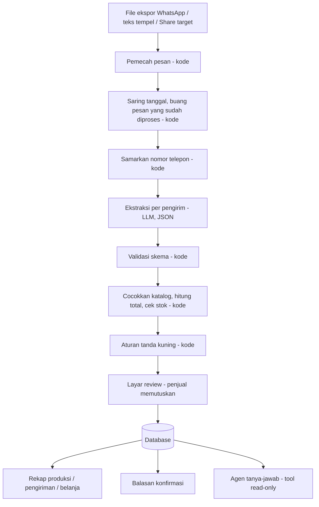

# Rekapesan

> **Dari chat grup jadi rekap pesanan, tanpa salin ulang.**

[](https://github.com/Baswara06/Rekapesan/actions/workflows/ci.yml)

Perekap pesanan pre-order (PO) makanan dari grup WhatsApp untuk penjual rumahan.
Dibuat untuk **LOGICODIX 2026** (HIMTI UNESA).

| | |
| --- | --- |
| **Kategori** | Web (mobile-first, PWA) |
| **Subtema** | Local MSME and Creative Economy |
| **Demo (deploy)** | https://rekapesan.my.id (API: https://api.rekapesan.my.id) |
| **Video demo** | _isi tautan YouTube_ |
| **Akun demo** | username `demo` / password: _isi_ (berisi katalog dan PO contoh). Bisa juga **Daftar** akun baru di layar Masuk |

---

## 1. Tim dan kontribusi

| Nama | Peran | Kontribusi |
| --- | --- | --- |
| Raihan | Backend, Hustler | CRUD API, auth, templat balasan, deploy, integrasi, wawancara penjual, video, README |
| Satria | Backend, ketua tim | Skema DB, mesin aturan, orkestrasi impor, rekap, parser ekspor WhatsApp, impor ulang, anonimisasi, data uji |
| Pangeran | Backend (AI) | Ekstraktor LLM, agen tanya-jawab, bukti bayar, evaluasi |
| Amad | Frontend | Seluruh antarmuka, PWA, aksesibilitas, uji pemakaian |

Rincian tugas: [`docs/PEMBAGIAN_TUGAS.md`](docs/PEMBAGIAN_TUGAS.md)

---

## 2. Masalah dan pengguna

**Pengguna:** penjual PO makanan rumahan (katering harian, kue, lauk, jajanan) yang membuka pesanan lewat grup WhatsApp.

> Penjual PO makanan perlu merekap pesanan harian dari grup WhatsApp, tetapi harus menggulir chat dan menyalin satu per satu ke buku atau Excel, sehingga ada pesanan terlewat, total salah hitung, dan jam kirim tertukar.

Tiga tanda masalah layak digarap:

| Tanda | Kondisi |
| --- | --- |
| Berulang | Terjadi setiap hari atau setiap batch PO |
| Informasi berantakan | Pesanan tersebar di ratusan baris chat bercampur obrolan |
| Keputusan tertunda | Jumlah produksi dan belanja baru diketahui setelah rekap manual selesai |

**Bukti lapangan:** _isi hasil wawancara dan pengukuran waktu penjual asli (sebelum vs sesudah). Jangan klaim angka yang tidak diukur._

---

## 3. Solusi

Penjual mengirim ekspor chat grup (atau menempel teksnya) ke Rekapesan. Sistem:

1. memecah chat menjadi pesan dan melewati pesan yang sudah pernah diproses,
2. menyamarkan nomor telepon,
3. memakai LLM **hanya** untuk memahami maksud pesanan dari teks bebas,
4. menghitung harga, total, dan stok dengan **kode biasa** dari katalog penjual,
5. menandai pesanan meragukan (tanda kuning) dan menunggu **persetujuan penjual**,
6. menghasilkan rekap produksi, urutan kirim, omzet, daftar belum bayar, dan balasan konfirmasi.

### Pembagian kerja AI dan kode

| Pekerjaan | Pelaksana |
| --- | --- |
| Memecah file ekspor menjadi pesan | Kode |
| Memahami maksud dan isi pesanan dari teks bebas | LLM |
| Harga, total, sisa stok | Kode |
| Menandai pesanan bermasalah | Kode |
| Memutuskan pesanan bermasalah | Penjual |

Harga tidak pernah dikirim ke LLM dan tidak pernah berasal dari LLM, sehingga manipulasi lewat isi chat tidak mengubah tagihan.

---

## 4. Fitur

- [x] Katalog menu (nama, alias, harga, stok harian, resep)
- [x] Impor ekspor chat (`.txt` / `.zip`) dan tempel teks
- [ ] Bagikan langsung dari WhatsApp (PWA share target, Android): sudah dibuat, belum diuji di HP Android
- [x] Ekstraksi pesanan dengan LLM, keluaran JSON tervalidasi skema
- [x] Layar review: chat asli berdampingan dengan hasil ekstraksi, tanda kuning
- [x] Rekap produksi per menu, urutan kirim per jam, omzet, belum bayar
- [x] Impor ulang tanpa pesanan dobel (sidik pesan)
- [x] Penanganan pesan "ubah" dan "batal"
- [x] Balasan konfirmasi per pembeli (templat, siap salin)
- [x] Agen tanya-jawab dengan tool calling (read-only) dan tampilan trace
- [x] Daftar belanja bahan baku dari resep per menu
- [x] Tanda "sudah bayar" dari tangkapan layar transfer (dikonfirmasi penjual)
- [x] Daftar dan masuk akun penjual (data tiap akun terpisah), hapus batch beserta pesan mentahnya
- [x] Uji otomatis backend dan frontend di CI (GitHub Actions)
- [ ] Evaluasi ekstraktor ke LLM di CI: job sudah ada, tetapi masih dilewati karena kunci LLM belum diatur di GitHub Secrets. Angka evaluasi di bagian 9 dari menjalankan penilai yang sama secara manual

_Centang yang benar-benar selesai. Jangan centang yang belum._

---

## 5. Arsitektur



Detail: [`docs/arsitektur.md`](docs/arsitektur.md) · Kontrak API: [`docs/api-contract.md`](docs/api-contract.md)

### Teknologi

| Lapisan | Teknologi |
| --- | --- |
| Backend | Python 3.11+, FastAPI, SQLAlchemy, Pydantic |
| Database | SQLite (lokal dan server demo) |
| LLM | Penyedia kompatibel OpenAI API (server demo: sumopod), model utama dan cadangan diatur lewat `.env` |
| Frontend | React + Vite + TypeScript, PWA |
| Uji | pytest (backend), Vitest (frontend) |
| CI | GitHub Actions |

---

## 6. Instalasi dan menjalankan

Prasyarat: Python 3.11+, Node 20+, [uv](https://docs.astral.sh/uv/) (disarankan).

```bash
# 1. Konfigurasi
cp .env.example .env        # isi LLM_API_KEY, DEMO_PASSWORD, dan APP_SECRET_KEY (min. 16 karakter)

# 2. Backend
cd backend
uv venv && uv pip install -r requirements.txt
uv run python -m app.seed   # data demo untuk akun demo (katalog + satu PO contoh), tanpa LLM
uv run uvicorn app.main:app --reload --port 8000

# 3. Frontend (terminal lain)
cd frontend
npm install
npm run dev                 # http://localhost:5173

# 4. Uji
cd backend && uv run pytest
cd frontend && npm test
```

Data contoh (samaran): [`sample/ekspor-contoh.txt`](sample/ekspor-contoh.txt)

Bila `DEMO_PASSWORD` kosong, atau `APP_SECRET_KEY` kosong, masih nilai bawaan, atau kurang dari 16 karakter, masuk dan daftar sengaja dimatikan dan layar Masuk menyebut isian `.env` yang kurang.

### Alur pemakaian

1. **Masuk** dengan akun demo, atau **Daftar** akun baru (nama pengguna dan kata sandi minimal 8 karakter). Setelah daftar langsung masuk.
2. Akun baru: isi **Katalog** dulu (nama menu, alias, harga, stok). Impor ditolak selama katalog masih kosong.
3. Buat **PO** (tanggal chat dibuka dan tanggal kirim), lalu **Masukkan chat**: ekspor `.txt`/`.zip` dari WhatsApp atau tempel teks.
4. **Review** pesanan bertanda kuning, perbaiki bila perlu, lalu setujui.
5. Lihat **Rekap** (produksi, urutan kirim, omzet, belum bayar) dan salin balasan konfirmasi ke pembeli.
6. Setelah PO selesai, hapus PO di Pengaturan. Pesan mentah ikut terhapus.

---

## 7. Dokumentasi penggunaan AI

| Penggunaan | Model / alat | Bagian |
| --- | --- | --- |
| Di dalam produk | `claude-haiku-5-5` lewat penyedia kompatibel OpenAI API (sumopod), cadangan otomatis `gpt-5.4-mini`. Model diatur di `.env` (`LLM_MODEL`, `LLM_FALLBACK_MODEL`, `VISION_MODEL`; bila `VISION_MODEL` kosong, bukti bayar memakai model utama) | Ekstraksi pesanan, agen tanya-jawab, pembacaan bukti bayar |
| Saat pengembangan | Claude Code (Anthropic) | Membantu menulis dan meninjau kode, uji, dan dokumentasi. Setiap perubahan masuk lewat Pull Request yang ditinjau anggota tim dan harus lulus uji CI |

Alasan pemilihan model ada di [`docs/evaluasi.md`](docs/evaluasi.md) (perbandingan lima model dengan penilai yang sama). Efisiensi: satu panggilan per pengirim, paralel, tanpa pemanggilan berulang kecuali keluaran tidak sah. Pesan yang sudah pernah diproses tidak dikirim lagi, dan impor ditolak sebelum memanggil LLM bila katalog masih kosong.

Data yang dikirim ke penyedia LLM: teks chat yang nomor teleponnya sudah disamarkan, dan daftar katalog (tanpa harga). Gambar bukti bayar dikirim hanya saat penjual menekan tombol baca.

---

## 8. Etika dan keamanan

- Nomor telepon disamarkan sebelum teks dikirim ke LLM.
- Isi chat diperlakukan sebagai data, bukan perintah (uji injeksi ada di `backend/tests`).
- Agen tanya-jawab memakai akses database **read-only**.
- Tidak ada pesanan final tanpa persetujuan penjual.
- Tombol hapus batch ikut menghapus pesan mentah.
- Kata sandi disimpan sebagai hash PBKDF2-SHA256, bukan teks asli.
- Data tiap akun terpisah: katalog, PO, pesanan, dan pesan mentah akun lain dijawab "tidak ditemukan". Agen tanya-jawab hanya bisa membaca PO milik akun yang bertanya, karena `batch_id` ditetapkan kode, bukan oleh model.
- API key hanya di `.env` (masuk `.gitignore`), `.env.example` tanpa nilai asli.
- Data contoh memakai nama dan alamat samaran. Chat asli hanya dipakai dengan izin penjual.

---

## 9. Hasil evaluasi

Ringkasan dari [`docs/evaluasi.md`](docs/evaluasi.md). Set uji: 40 kasus **sintetis** buatan tim (belum chat penjual asli), satu kasus = satu panggilan ekstraktor untuk satu pengirim. Model `claude-haiku-5-5`, satu kali jalan, 13 November 2026.

| Kategori | Jumlah | Persen |
| --- | --- | --- |
| Benar seluruhnya | 39 | 97,5% |
| Salah, tertangkap tanda kuning | 0 | 0,0% |
| Salah, **lolos tanpa tanda** | 1 | 2,5% |

Kasus sulit: ubah pesanan 5/5, batal 3/3, item tidak ada di katalog 3/3, jumlah tidak wajar 2/2, percobaan manipulasi harga (prompt injection) 4/4. Satu kesalahan (g16) adalah kasus ambigu: model memasukkan "lobi" ke catatan, bukan alamat. Di aplikasi pesanan itu tetap diberi tanda `alamat_kosong`, tetapi penilai tidak menghitungnya sebagai tertangkap. Gold tidak diubah supaya angka tetap apa adanya.

Set uji kecil dan sintetis, jadi angka ini belum mewakili chat penjual sungguhan.

## 10. Batasan yang diketahui

- Akun: belum ada verifikasi email dan fitur lupa kata sandi (aplikasi belum mengirim email). Satu akun untuk satu penjual, belum ada akun staf atau peran.
- Profil toko (nama toko di balasan konfirmasi) belum ada.
- Format ekspor diuji pada contoh Android, iPhone (bahasa Indonesia dan Inggris), dan salinan WhatsApp Web. Format bahasa atau wilayah lain belum diuji.
- Bagikan langsung dari WhatsApp (share target) hanya untuk PWA di Android. iPhone tidak mendukung fitur ini, jadi pengguna iPhone memakai unggah berkas atau tempel teks.
- Evaluasi ekstraktor memakai 40 kasus sintetis. Akurasi pada chat penjual sungguhan belum diukur.
- Ambang "jumlah tidak wajar" masih diatur lewat `.env` (`JUMLAH_TIDAK_WAJAR_DEFAULT`), belum bisa diubah dari aplikasi.
- Server demo memakai SQLite di hosting bersama (cPanel), cukup untuk demo tetapi belum diuji untuk banyak penjual sekaligus.

## 11. Atribusi

| Bagian | Sumber | Lisensi |
| --- | --- | --- |
| Font | Fraunces dan Plus Jakarta Sans lewat Fontsource | SIL Open Font License 1.1 |
| Ikon dan logo | Dibuat sendiri oleh tim (SVG di `frontend/src/components/Icon.tsx` dan `Logo.tsx`) | - |
| Frontend | React, Vite, Vitest, Testing Library, jsdom | MIT |
| Backend | FastAPI, SQLAlchemy, Pydantic, pydantic-settings, pytest (MIT); Uvicorn, HTTPX (BSD-3-Clause); OpenAI Python SDK, python-multipart, a2wsgi untuk deploy cPanel (Apache-2.0) | sesuai kolom |
| Data contoh dan gold set | Dibuat tim, nama, alamat, dan nomor samaran (`sample/`) | - |
| Model AI | Diakses lewat API penyedia (lihat bagian 7), tidak didistribusikan di repo | sesuai ketentuan penyedia |
