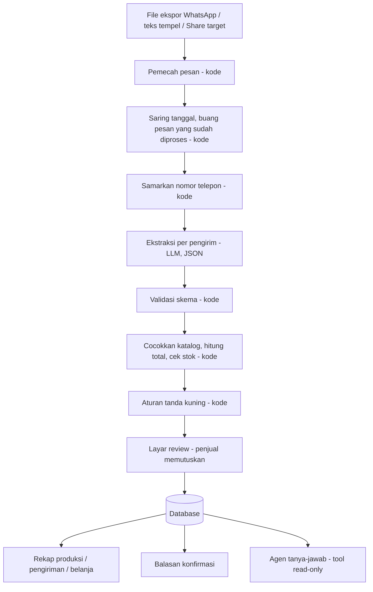

# Rekapesan

> **Dari chat grup jadi rekap pesanan, tanpa salin ulang.**

Perekap pesanan pre-order (PO) makanan dari grup WhatsApp untuk penjual rumahan.
Dibuat untuk **LOGICODIX 2026** (HIMTI UNESA).

| | |
| --- | --- |
| **Kategori** | Web (mobile-first, PWA) |
| **Subtema** | Local MSME and Creative Economy |
| **Demo (deploy)** | _isi setelah deploy_ |
| **Video demo** | _isi tautan YouTube_ |
| **Akun demo** | username `demo` / password: _isi_ |

---

## 1. Tim dan kontribusi

| Nama | Peran | Kontribusi |
| --- | --- | --- |
| Raihan | Backend, Hustler | CRUD API, auth, templat balasan, deploy, integrasi, wawancara penjual, video, README |
| Satria | Backend, ketua tim | Skema DB, mesin aturan, orkestrasi impor, rekap, parser ekspor WhatsApp, impor ulang, anonimisasi, data uji |
| Pangeran | Backend (AI) | Ekstraktor LLM, agen tanya-jawab, bukti bayar, evaluasi |
| Amad | Frontend | Seluruh antarmuka, PWA, aksesibilitas, uji pemakaian |

Rincian tugas: [`docs/PEMBAGIAN_TUGAS.md`](docs/PEMBAGIAN_TUGAS.md)

---

## 2. Masalah dan pengguna

**Pengguna:** penjual PO makanan rumahan (katering harian, kue, lauk, jajanan) yang membuka pesanan lewat grup WhatsApp.

> Penjual PO makanan perlu merekap pesanan harian dari grup WhatsApp, tetapi harus menggulir chat dan menyalin satu per satu ke buku atau Excel, sehingga ada pesanan terlewat, total salah hitung, dan jam kirim tertukar.

Tiga tanda masalah layak digarap:

| Tanda | Kondisi |
| --- | --- |
| Berulang | Terjadi setiap hari atau setiap batch PO |
| Informasi berantakan | Pesanan tersebar di ratusan baris chat bercampur obrolan |
| Keputusan tertunda | Jumlah produksi dan belanja baru diketahui setelah rekap manual selesai |

**Bukti lapangan:** _isi hasil wawancara dan pengukuran waktu penjual asli (sebelum vs sesudah). Jangan klaim angka yang tidak diukur._

---

## 3. Solusi

Penjual mengirim ekspor chat grup (atau menempel teksnya) ke Rekapesan. Sistem:

1. memecah chat menjadi pesan dan melewati pesan yang sudah pernah diproses,
2. menyamarkan nomor telepon,
3. memakai LLM **hanya** untuk memahami maksud pesanan dari teks bebas,
4. menghitung harga, total, dan stok dengan **kode biasa** dari katalog penjual,
5. menandai pesanan meragukan (tanda kuning) dan menunggu **persetujuan penjual**,
6. menghasilkan rekap produksi, urutan kirim, omzet, daftar belum bayar, dan balasan konfirmasi.

### Pembagian kerja AI dan kode

| Pekerjaan | Pelaksana |
| --- | --- |
| Memecah file ekspor menjadi pesan | Kode |
| Memahami maksud dan isi pesanan dari teks bebas | LLM |
| Harga, total, sisa stok | Kode |
| Menandai pesanan bermasalah | Kode |
| Memutuskan pesanan bermasalah | Penjual |

Harga tidak pernah dikirim ke LLM dan tidak pernah berasal dari LLM, sehingga manipulasi lewat isi chat tidak mengubah tagihan.

---

## 4. Fitur

- [ ] Katalog menu (nama, alias, harga, stok harian)
- [ ] Impor ekspor chat (`.txt` / `.zip`), tempel teks, dan bagikan langsung dari WhatsApp (PWA share target, Android)
- [ ] Ekstraksi pesanan dengan LLM, keluaran JSON tervalidasi skema
- [ ] Layar review: chat asli berdampingan dengan hasil ekstraksi, tanda kuning
- [ ] Rekap produksi per menu, urutan kirim per jam, omzet, belum bayar
- [ ] Impor ulang tanpa pesanan dobel (sidik pesan)
- [ ] Penanganan pesan "ubah" dan "batal"
- [ ] Balasan konfirmasi per pembeli (templat, siap salin)
- [ ] Agen tanya-jawab dengan tool calling (read-only) dan tampilan trace
- [ ] Daftar belanja bahan baku dari resep per menu
- [ ] Tanda "sudah bayar" dari tangkapan layar transfer (dikonfirmasi penjual)
- [ ] Autentikasi dan hapus batch beserta pesan mentahnya
- [ ] Evaluasi otomatis di CI

_Centang yang benar-benar selesai. Jangan centang yang belum._

---

## 5. Arsitektur



Detail: [`docs/arsitektur.md`](docs/arsitektur.md) · Kontrak API: [`docs/api-contract.md`](docs/api-contract.md)

### Teknologi

| Lapisan | Teknologi |
| --- | --- |
| Backend | Python 3.11+, FastAPI, SQLAlchemy, Pydantic |
| Database | SQLite (lokal), PostgreSQL (deploy) |
| LLM | Penyedia kompatibel OpenAI API (OpenRouter / NVIDIA NIM), model diatur lewat `.env` |
| Frontend | React + Vite + TypeScript, PWA |
| Uji | pytest (backend), Vitest (frontend) |
| CI | GitHub Actions |

---

## 6. Instalasi dan menjalankan

Prasyarat: Python 3.11+, Node 20+, [uv](https://docs.astral.sh/uv/) (disarankan).

```bash
# 1. Konfigurasi
cp .env.example .env        # isi LLM_API_KEY dan nilai lain

# 2. Backend
cd backend
uv venv && uv pip install -r requirements.txt
uv run uvicorn app.main:app --reload --port 8000

# 3. Frontend (terminal lain)
cd frontend
npm install
npm run dev                 # http://localhost:5173

# 4. Uji
cd backend && uv run pytest
cd frontend && npm test
```

Data contoh (samaran): [`sample/ekspor-contoh.txt`](sample/ekspor-contoh.txt)

---

## 7. Dokumentasi penggunaan AI

| Penggunaan | Model / alat | Bagian |
| --- | --- | --- |
| Di dalam produk | _isi nama model dan penyedia_ | Ekstraksi pesanan, agen tanya-jawab, pembacaan bukti bayar |
| Saat pengembangan | _isi, misalnya Claude Code_ | _isi bagian apa saja yang dibantu_ |

Data yang dikirim ke penyedia LLM: teks chat yang nomor teleponnya sudah disamarkan, dan daftar katalog (tanpa harga). Gambar bukti bayar dikirim hanya saat penjual menekan tombol baca.

---

## 8. Etika dan keamanan

- Nomor telepon disamarkan sebelum teks dikirim ke LLM.
- Isi chat diperlakukan sebagai data, bukan perintah (uji injeksi ada di `backend/tests`).
- Agen tanya-jawab memakai akses database **read-only**.
- Tidak ada pesanan final tanpa persetujuan penjual.
- Tombol hapus batch ikut menghapus pesan mentah.
- API key hanya di `.env` (masuk `.gitignore`), `.env.example` tanpa nilai asli.
- Data contoh memakai nama dan alamat samaran. Chat asli hanya dipakai dengan izin penjual.

---

## 9. Hasil evaluasi

_Isi dari [`docs/evaluasi.md`](docs/evaluasi.md) apa adanya, termasuk angka "salah dan lolos tanpa tanda"._

## 10. Batasan yang diketahui

_Isi jujur. Contoh: share target tidak didukung PWA di iPhone, format ekspor diuji pada Android dan iPhone dengan bahasa tertentu saja._

## 11. Atribusi

_Isi template, ikon, font, dataset, atau kode pihak ketiga yang dipakai._
