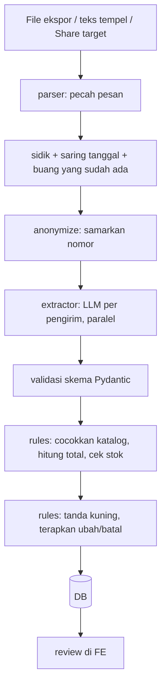

# Arsitektur Rekapesan

## Prinsip

LLM dipakai hanya untuk memahami teks tidak terstruktur. Semua yang deterministik (harga, total, stok, tanda kuning, rekap, balasan konfirmasi) dihitung kode. Penjual memutuskan semua yang meragukan.

## Alur impor

## Modul dan pemilik

| Modul | Folder | Pemilik |
| --- | --- | --- |
| API CRUD, auth, templat balasan | `backend/app/api`, `core` | Raihan |
| Skema DB, rekap | `backend/app/db` | Satria |
| Mesin aturan, orkestrasi impor | `backend/app/rules`, `services` | Satria |
| Parser, sidik, anonimisasi | `backend/app/parser` | Satria |
| Ekstraktor, agen, vision | `backend/app/extractor`, `agent` | Pangeran |
| Frontend + PWA | `frontend/` | Amad |

## Antarmuka antar-modul

| Dari → Ke | Fungsi |
| --- | --- |
| parser → services | `parse_export(file_or_text, batch_date) -> list[Message]` |
| parser → extractor | `anonymize(text) -> str` |
| services → extractor | `extract_orders(sender_messages, catalog, active_order) -> Extraction` |
| extractor → rules | `Extraction` (intent, items, tanggal, jam, alamat, catatan) |
| rules → services | `apply_intent(order_context, extraction) -> OrderChange` |
| agent → DB | koneksi **read-only** |

### Rincian yang disepakati (modul Satria)

- **`parse_export(file_or_text, batch_date)`**: `batch_date` adalah **tanggal chat PO dibuka** (`batches.tanggal_mulai`), bukan tanggal kirim. Pesan sebelum tanggal itu dibuang. `None` berarti tanpa saringan. Masukan boleh teks tempel, bytes `.txt`, bytes `.zip`, atau berkas terbuka. Format tak dikenal melempar `FormatTidakDikenal` (kode API `format_file_tidak_dikenal`).
- **Sidik**: `sha256(waktu dibulatkan ke menit + pengirim + isi + urutan)`. `urutan` adalah nomor urut pesan kembar (pengirim dan isi sama) di menit yang sama. Unik per batch di tabel `messages`.
- **`anonymize(text)`**: nomor telepon menjadi `[nomor]`, surel menjadi `[email]`, deret 10 digit atau lebih (rekening, NIK) menjadi `[angka]`. Nama pengirim berupa nomor ikut disamarkan sebelum ke LLM, tetapi di DB tetap asli untuk penjual.
- **`extract_orders(..., active_order)`**: `active_order` yang dikirim ke ekstraktor berisi `jam_kirim`, `alamat`, `catatan`, dan `items` (`product_id`, `teks_asli`, `qty`, `catatan_item`). **Tanpa harga dan tanpa total.** Untuk intent `ubah`, `items` adalah **daftar akhir lengkap** pesanan; `items` kosong berarti item tidak berubah (hanya jam/alamat/catatan).
- **`apply_intent(order_context, extraction)`**: bentuk `order_context` ada di docstring `backend/app/rules/engine.py` (`catalog`, `active_order`, `terpakai`, `ambang_jumlah_tidak_wajar`). Hasilnya selalu `perlu_cek` (atau `batal`); pesanan yang sudah dikonfirmasi lalu diubah pembeli kembali ke `perlu_cek`.
- **Impor**: `services.import_batch(db, batch_id, file_or_text, extractor=None)`. Ekstraktor yang gagal untuk sebagian pengirim menghasilkan pesanan bertanda `gagal_diekstrak`, impor tetap lanjut. Bila gagal untuk **semua** pengirim, impor dibatalkan tanpa menyimpan apa pun dan melempar `EkstraksiGagalTotal` (kode API `kuota_llm_habis` untuk HTTP 429 dari penyedia, selain itu `llm_gagal`), supaya penjual bisa mengulang. Syaratnya ekstraktor **melempar galat** saat penyedia utama dan cadangan sama-sama gagal, bukan mengembalikan `gagal=True`. Dua impor bersamaan ke batch yang sama: yang kalah melempar `ImporBentrok` (HTTP 409, kode `impor_bentrok`).
- **Stok**: `stok_kurang` dibagi menurut **urutan pesanan masuk**. Pesanan hanya bertanda bila pesanan yang masuk lebih dulu (dan belum batal) ditambah dirinya melebihi stok harian; pesanan yang masuk belakangan tidak pernah menandai pesanan sebelumnya. `services.segarkan_tanda_stok(db, batch_id)` menghitung ulang tanda ini untuk seluruh batch dan dipanggil setelah impor, ubah, tolak, dan buka lagi, supaya tidak ada tanda basi.
- **Rekap**: `services.build_recap(db, batch_id)` dan `services.build_shopping_list(db, batch_id)`. Hanya pesanan yang disetujui (`dikonfirmasi`, `dibayar`, `dikirim`) yang dihitung. `Recap` mendapat tambahan `menunggu_persetujuan` (jumlah pesanan `perlu_cek`). `belum_bayar` = pesanan berstatus `dikonfirmasi`.
- **DB**: model di `backend/app/db/models.py`, sesi lewat `get_db` (API) dan `get_readonly_session()` (agen; database menolak tulis). Tabel dibuat `init_db()` saat aplikasi mulai, belum memakai alat migrasi.

## Keamanan

- Harga tidak dikirim ke LLM, tidak diterima dari LLM.
- `product_id` dari LLM divalidasi terhadap DB, id tak dikenal menjadi `null`.
- Isi chat diperlakukan sebagai data, bukan instruksi.
- Agen: tool hanya baca, DB read-only, guardrail di system prompt.
- Kredensial hanya di `.env`.
- Akun: akun demo dari `.env`, akun lain lewat `POST /auth/register` (kata sandi di-hash PBKDF2-SHA256, tabel `users`).
- Data terpisah per akun: `products.pemilik` dan `batches.pemilik` berisi username di token. Pesanan, pembeli, pesan mentah, bukti bayar, rekap, dan agen ikut pemilik batch. Pemeriksaan ada di `backend/app/api/kepemilikan.py`. Data akun lain dijawab 404. Katalog yang dikirim ke LLM saat impor hanya milik pemilik batch.

