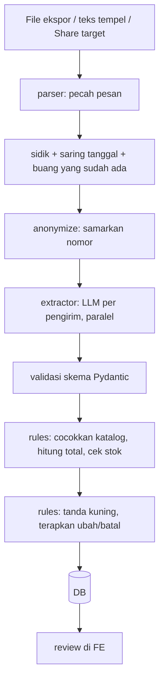

# Arsitektur Rekapesan

## Prinsip

LLM dipakai hanya untuk memahami teks tidak terstruktur. Semua yang deterministik (harga, total, stok, tanda kuning, rekap, balasan konfirmasi) dihitung kode. Penjual memutuskan semua yang meragukan.

## Alur impor

## Modul dan pemilik

| Modul | Folder | Pemilik |
| --- | --- | --- |
| API CRUD, auth, templat balasan | `backend/app/api`, `core` | Raihan |
| Skema DB, rekap | `backend/app/db` | Satria |
| Mesin aturan, orkestrasi impor | `backend/app/rules`, `services` | Satria |
| Parser, sidik, anonimisasi | `backend/app/parser` | Satria |
| Ekstraktor, agen, vision | `backend/app/extractor`, `agent` | Pangeran |
| Frontend + PWA | `frontend/` | Amad |

## Antarmuka antar-modul

| Dari → Ke | Fungsi |
| --- | --- |
| parser → services | `parse_export(file_or_text, batch_date) -> list[Message]` |
| parser → extractor | `anonymize(text) -> str` |
| services → extractor | `extract_orders(sender_messages, catalog, active_order) -> Extraction` |
| extractor → rules | `Extraction` (intent, items, tanggal, jam, alamat, catatan) |
| rules → services | `apply_intent(order_context, extraction) -> OrderChange` |
| agent → DB | koneksi **read-only** |

## Keamanan

- Harga tidak dikirim ke LLM, tidak diterima dari LLM.
- `product_id` dari LLM divalidasi terhadap DB, id tak dikenal menjadi `null`.
- Isi chat diperlakukan sebagai data, bukan instruksi.
- Agen: tool hanya baca, DB read-only, guardrail di system prompt.
- Kredensial hanya di `.env`.
